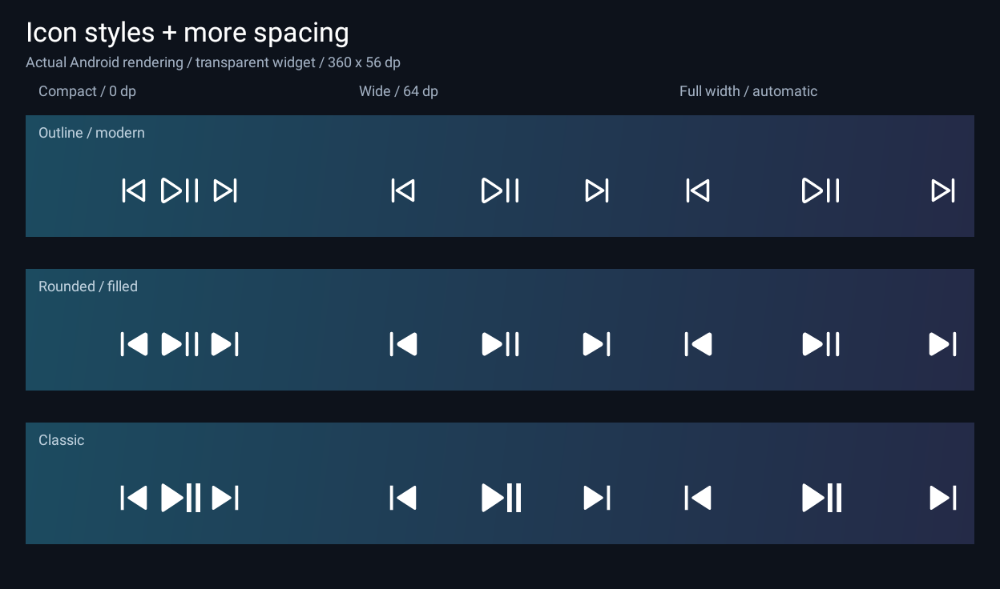
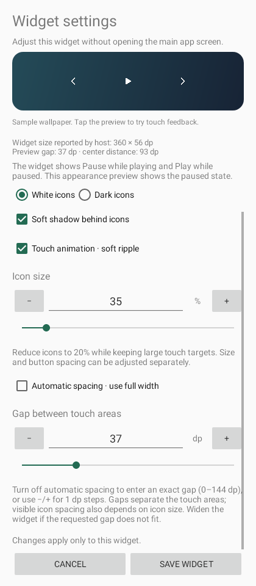

# Arke Media Controls

Skip a track, pause a podcast, or adjust media volume without opening your player. Put playback controls in a Samsung Routine or keep them on your Android home screen in a widget you can resize and style.

**[Download the phone APK](https://github.com/brenopoubel0324/media-actions-for-routines-app/releases/download/v0.38/arke-media-controls-phone-0.38.apk)** · **Stable 0.38** · Android 13 or later

[SHA-256 checksum](https://github.com/brenopoubel0324/media-actions-for-routines-app/releases/download/v0.38/SHA256SUMS.txt) · [Release notes](https://github.com/brenopoubel0324/media-actions-for-routines-app/releases/tag/v0.38)

*Android/Skia render of the refined icon, with a simulated launcher mask. Appearance can vary by launcher and device.*

**Previously Media Actions.** Arke Media Controls updates the same original app. Install it over Media Actions 0.36 or Arke 0.37 without uninstalling to keep your settings and widgets. The app ID, signing identity, action identifiers, and backup format remain the same.

## Get started

1. Download `arke-media-controls-phone-0.38.apk` from [Releases](https://github.com/brenopoubel0324/media-actions-for-routines-app/releases). Install it over the original app to keep your settings and widgets. If you use the separate **Media Actions Preview**, follow the [Preview migration steps](https://github.com/brenopoubel0324/media-actions-for-routines-app/releases/tag/v0.27-preview-migration) first.
2. Open Arke Media Controls, allow **Notification access** for playback controls, start a media player, and try the test buttons. Android may ask you to allow restricted settings for a sideloaded app.
3. Open Samsung **Modes and Routines** and choose **Open an app or do an app action → Arke Media Controls**. Pick **Previous**, **Play/Pause**, or **Next**. To use a widget instead, add one from your launcher’s widget picker.

Samsung Routines, Routines+ gestures, and LockStar widget placement depend on your device and One UI version. Playback needs a local media session that exposes the requested action. Remote playback such as Spotify Connect may not expose one.

## About the name

In Greek mythology, Arke is a messenger of the Titans. The violet winged profile takes that reference as inspiration for carrying a command to your player through a widget, routine, or watch action. That connection to media controls is a modern interpretation created for the app. You can read the explanation locally in **Help and diagnostics → About the name Arke**. [Mythological reference](https://en.wikipedia.org/wiki/Arke).

Version 0.38 refines the messenger’s wing and profile and adds a subtle gradient to the icon background. The monochrome icon remains available for themed icons on compatible launchers.

## Make the widget your own

- **Media controls** puts Previous, Play/Pause, and Next in one widget.
- **Media volume** adjusts local volume without Notification access or an active media session.
- **Playback and volume** gives you volume down, Play/Pause, and volume up in one place.

Open **Edit existing widget** to set the layout, spacing, borders, or colors for each widget. Choose transparent controls, filled buttons, or a capsule background, with separate colors for the widget, the controls, and Play/Pause. Existing widgets keep their saved look. If LockStar offers no edit action, use the editor in Arke Media Controls.

*Android-rendered preview from an earlier build, showing icon styles and spacing. The background is illustrative.*

See the widget editor

*Test-environment capture from an earlier build. The editor layout has since changed.*

## Updates and Preview migration

Updates over the original Media Actions or Arke installation preserve its existing settings and widgets. Keep the app installed while updating. Arke exports backup format v6 and imports v1–v6.

**Media Actions Preview is a separate app.** Install the [Preview 0.27 migration update](https://github.com/brenopoubel0324/media-actions-for-routines-app/releases/tag/v0.27-preview-migration) over Preview first. Export and verify your backup, then import it into Arke Media Controls. Recreate widgets and reapply saved profiles before removing Preview. Keep older backups if you may need to return to Media Actions 0.35 or earlier.

## Wear OS

The optional [Wear OS companion (0.9 experimental)](https://github.com/brenopoubel0324/media-actions-for-routines-app/releases/tag/wear-v0.9-experimental) exposes Previous, Play/Pause, and Next as entries you can choose in **Wear Button Remapper**. Install the companion on the watch and use the stable APK on the phone. Physical button bindings and playback on the watch still need validation on the Galaxy Watch8 test firmware.

## Privacy and support

Playback controls use Android’s Notification access to reach media sessions. Arke Media Controls does not read or store notification content. Phone widgets and routines act locally. The optional watch companion uses Google Play services Data Layer, which can use Bluetooth or Google's network infrastructure.

[Report a problem](https://github.com/brenopoubel0324/media-actions-for-routines-app/issues/new) with your app version, device model, Android or One UI version, and whether it happened in a routine, widget, or watch shortcut. Leave out personal notification content, account information, and device identifiers.

[Third-party notices](THIRD_PARTY_NOTICES.md)
